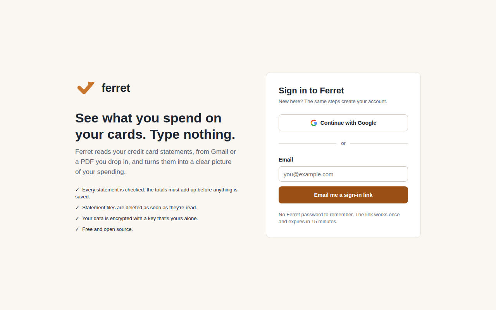
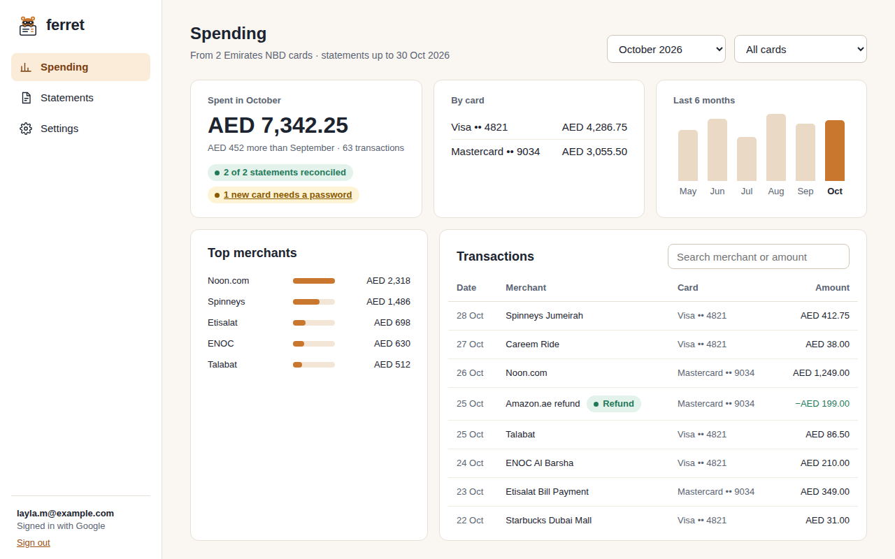
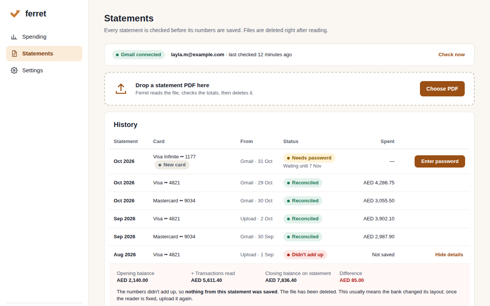
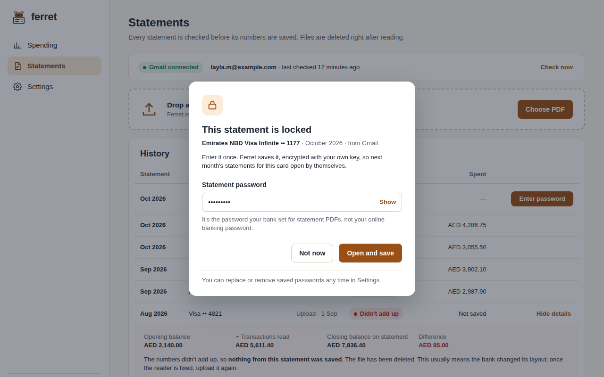
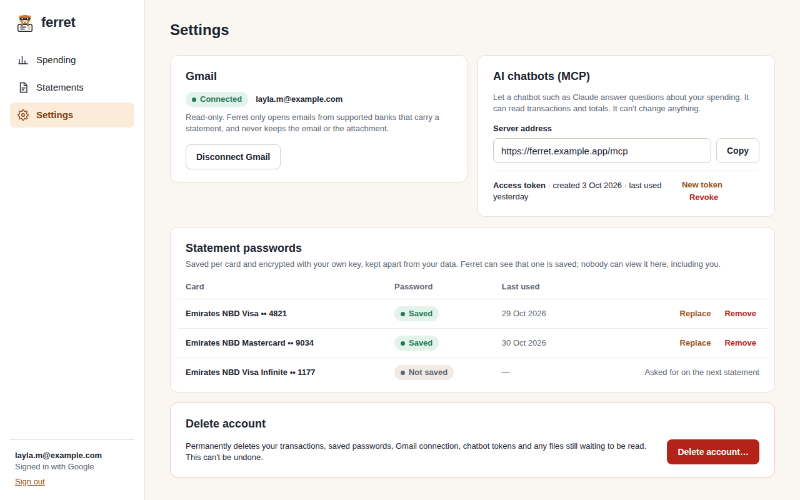

<!-- about -->
# Ferret

**Credit card spending visibility from your statements, with no manual entry**

## Screens

### S01 · Sign in

Sign in or create an account without a Ferret password

### S02 · Spending

See what you spent this month, per card, at which merchants, and every transaction

### S03 · Statements

Bring statements in (Gmail or PDF) and see whether each one added up

### S04 · Statement password

Enter a statement PDF's password once so this card's statements open by themselves from then on

### S05 · Settings

Control Gmail, saved statement passwords, chatbot access and the account

<!-- /about -->

## Development

The engineer adds build and test instructions here as the code lands.

---

Created with ❤️ by Dunder Mifflin agents
